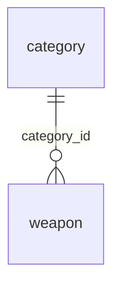

# mw4-data-analysis

# テーブル構成

データベース名：`mw4`（文字コード utf8mb4）

## 一覧

| テーブル | 内容 | 件数 |
|---|---|---|
| category | 武器カテゴリー | 2 |
| weapon | 武器本体のステータス | 10 |
| muzzle | アタッチメント：マズル | 16 |
| barrel | アタッチメント：バレル | 9 |
| laser | アタッチメント：レーザー | 14 |
| site | アタッチメント：サイト | 23 |
| stock | アタッチメント：ストック | 8 |
| underbarrel | アタッチメント：アンダーバレル | 12 |
| ammo | アタッチメント：弾薬 | 10 |
| rear_grip | アタッチメント：リアグリップ | 6 |
| magazine | アタッチメント：マガジン | 4 |

## 関連



アタッチメントの各テーブルは `weapon_id` で武器に紐付く（今は HAN 86 と VEL 46 の分。site は HAN 86 のみ）。

---

## category

武器カテゴリー。

| カラム | 型 | NULL | キー | 内容 |
|---|---|---|---|---|
| id | INT | × | PK（自動採番） | |
| name | VARCHAR(50) | × | UNIQUE | カテゴリー名 |

| id | name |
|---|---|
| 1 | アサルト |
| 2 | サブマシンガン |

---

## weapon

武器本体のステータス。ゲーム内の詳細ステータス画面の値を、銃 1 丁につき 1 行で持つ。

- 画面上で「なし」と表示される項目は NULL
- 単位は列には含めず、下表の「単位」の通りに数値だけを入れる

### 基本

| カラム | 型 | NULL | キー | 内容 | 単位 |
|---|---|---|---|---|---|
| id | INT | × | PK（自動採番） | | |
| name | VARCHAR(100) | × | | 武器名 | |
| category_id | INT | ○ | FK → category.id | カテゴリー | |
| fire_mode | VARCHAR(50) | ○ | | 射撃モード（例：`セミ,オート`） | |

### バー（5 項目）

| カラム | 型 | 内容 |
|---|---|---|
| power | INT | 威力 |
| range | INT | 射程距離 |
| accuracy | INT | 命中率 |
| mobility | INT | 機動性 |
| handling | INT | 操作性 |

`range` は MySQL の予約語なので、SQL ではバッククォートで囲む。

### 連射速度

| カラム | 型 | 内容 | 単位 |
|---|---|---|---|
| rpm | INT | 連射速度 | RPM |
| pre_fire_delay | INT | 射撃前遅延 | ms |
| rechamber_speed | INT | 再装填速度 | ms |

### 威力

| カラム | 型 | 内容 | 単位 |
|---|---|---|---|
| penetration | DECIMAL(5,1) | 弾丸の貫通力 | インチ |
| flinch | DECIMAL(4,2) | ひるみ付与 | X |

### 機動性

| カラム | 型 | 内容 | 単位 |
|---|---|---|---|
| move_speed | DECIMAL(4,2) | 移動速度 | m/s |
| ads_move_speed | DECIMAL(4,2) | エイム時移動速度 | m/s |
| fire_move_speed | DECIMAL(4,2) | 射撃時の移動速度 | m/s |
| strafe_speed | DECIMAL(4,2) | 横移動速度 | m/s |
| crouch_speed | DECIMAL(4,2) | しゃがみ速度 | m/s |
| sprint_speed | DECIMAL(4,2) | ダッシュ速度 | m/s |
| tac_sprint_speed | DECIMAL(4,2) | タクティカルダッシュ速度 | m/s |
| tac_sprint_duration | DECIMAL(4,1) | タクティカルダッシュ持続時間 | 秒 |

### 射程距離

| カラム | 型 | 内容 | 単位 |
|---|---|---|---|
| muzzle_velocity | DECIMAL(6,1) | マズル速度 | m/s |
| zoom | DECIMAL(3,1) | ズーム倍率 | X |

### 弾薬

| カラム | 型 | 内容 |
|---|---|---|
| magazine_size | INT | 装弾数 |
| reserve_ammo | INT | 予備弾数 |

### 操作性

| カラム | 型 | 内容 | 単位 |
|---|---|---|---|
| ads_in_time | INT | エイム開始速度 | ms |
| ads_out_time | INT | エイム解除速度 | ms |
| sprint_to_fire | INT | ダッシュ後射撃速度 | ms |
| raise_time | INT | 構え速度 | ms |
| drop_time | INT | ドロップ速度 | ms |
| reload_time | INT | リロード速度 | ms |

### 命中率（エイム時）

| カラム | 型 | 内容 | 単位 |
|---|---|---|---|
| ads_recoil_h | DECIMAL(5,1) | エイム時の水平反動制御 | °/s |
| ads_recoil_v | DECIMAL(5,1) | エイム時の垂直反動制御 | °/s |
| ads_kick_h | DECIMAL(5,1) | エイム時の水平ガンキック | °/s |
| ads_kick_v | DECIMAL(5,1) | エイム時の垂直ガンキック | °/s |
| ads_spread | DECIMAL(5,2) | エイム時のブレ | °/s |
| ads_sway | DECIMAL(5,2) | エイム時の銃の揺れ | ° |
| ads_rechamber_accuracy | DECIMAL(5,2) | エイム時再装填精度 | |

### 命中率（腰だめ撃ち）

| カラム | 型 | 内容 | 単位 |
|---|---|---|---|
| hip_recoil_h | DECIMAL(5,1) | 腰だめ撃ち時の水平反動制御 | °/s |
| hip_recoil_v | DECIMAL(5,1) | 腰だめ撃ち時の垂直反動制御 | °/s |
| hip_kick_h | DECIMAL(5,1) | 腰だめ撃ち時の水平ガンキック | °/s |
| hip_kick_v | DECIMAL(5,1) | 腰だめ撃ち時の垂直ガンキック | °/s |
| hip_spread | DECIMAL(5,2) | 腰だめ撃ち時のブレ | °/s |
| hip_sway | DECIMAL(5,2) | 腰だめ撃ち時の銃の揺れ | ° |
| hip_rechamber_accuracy | DECIMAL(5,2) | 腰だめ撃ち時の再装填精度 | |
| hip_turn_spread | DECIMAL(5,1) | 腰だめ撃ち旋回時のブレ | ° |
| hip_strafe_accuracy | DECIMAL(5,2) | 横移動時の腰だめ撃ち命中率 | ° |
| hit_flinch | DECIMAL(4,2) | 被弾時のひるみ | X |

### 部位別ダメージ

画面のダメージ分布の数値を、上から順に入れる。

| カラム | 型 | 内容 |
|---|---|---|
| dmg_head | INT | 頭 |
| dmg_head_multiplier | DECIMAL(3,2) | 頭の倍率（`29 (X1.3)` の 1.3） |
| dmg_neck | INT | 首 |
| dmg_upper_torso | INT | 胸 |
| dmg_lower_torso | INT | 腹 |
| dmg_upper_arm | INT | 上腕 |
| dmg_lower_arm | INT | 前腕 |
| dmg_upper_leg | INT | 太もも |
| dmg_lower_leg | INT | すね |

### 距離別ダメージ

最大 4 段階。使わない段階は NULL。最後の段階は `max` を NULL（＝∞）にする。

| カラム | 型 | 内容 | 単位 |
|---|---|---|---|
| range1_max | INT | 1 段階目の距離上限 | m |
| range1_damage | INT | 1 段階目のダメージ | |
| range2_max | INT | 2 段階目の距離上限 | m |
| range2_damage | INT | 2 段階目のダメージ | |
| range3_max | INT | 3 段階目の距離上限 | m |
| range3_damage | INT | 3 段階目のダメージ | |
| range4_max | INT | 4 段階目の距離上限 | m |
| range4_damage | INT | 4 段階目のダメージ | |

例：

| 画面の表示 | range1_max | range1_damage | range2_max | range2_damage | range3_max | range3_damage | range4_max | range4_damage |
|---|---|---|---|---|---|---|---|---|
| 0-30: 23 / 30-∞: 19 | 30 | 23 | NULL | 19 | NULL | NULL | NULL | NULL |
| 0-21: 31 / 21-43: 25 / 43-∞: 22 | 21 | 31 | 43 | 25 | NULL | 22 | NULL | NULL |
| 0-10: 20 / 10-17: 17 / 17-24: 15 / 24-∞: 14 | 10 | 20 | 17 | 17 | 24 | 15 | NULL | 14 |

---

## アタッチメント（9 テーブル共通）

`muzzle` / `barrel` / `laser` / `site` / `stock` / `underbarrel` / `ammo` / `rear_grip` / `magazine` はすべて同じ構成。

weapon と同じステータス列を持つ（`category_id` と `fire_mode` は除く）。値はアタッチメントを付けたときの元の武器のステータスからの**増減**で、プラスもマイナスもある。変化しない項目は 0。全列 NULL 不可・初期値 0。

### アタッチメント専用の列

| カラム | 型 | NULL | キー | 内容 |
|---|---|---|---|---|
| id | INT | × | PK（自動採番） | |
| weapon_id | INT | × | FK → weapon.id | 対応する武器 |
| ident | INT | × | UNIQUE（weapon_id, ident） | 武器ごとのアタッチメント番号（1, 2, 3 …） |
| name | VARCHAR(100) | × | | アタッチメント名 |

### ステータス列

| カラム | 型 | 内容 |
|---|---|---|
| power / range / accuracy / mobility / handling | INT | バーの増減値（例：+7、-4） |
| rpm / magazine_size / reserve_ammo | INT | 増減値 |
| 上記以外（pre_fire_delay 〜 range4_damage） | DECIMAL(6,2) | 元の武器のステータスからの増減率（%） |

列の名前と並び順は weapon と同じ。各列の意味は上の weapon の表を参照。

---

## incompatible.json

武器ごとに「付けられないアタッチメント」と「一緒に付けられない組み合わせ」を書くファイル。ルートに置く。

```json
{
  "10": {
    "unavailable": {
      "stock": [3],
      "laser": [5, 6]
    },
    "incompatible": [
      ["stock:1", "muzzle:2"],
      ["underbarrel:4", "barrel:2"]
    ]
  }
}
```

| 項目 | 内容 |
|---|---|
| `"10"` などのキー | 武器の id（weapon テーブルの id）。JSON のキーは文字列なので `"10"` と書く |
| `unavailable` | その武器では付けられないアタッチメント。`{スロット名: [ident, ...]}` |
| `incompatible` | 一緒に付けられない組み合わせの 2 次元配列。1 組は `["スロット名:ident", "スロット名:ident"]` |

- スロット名はテーブル名：`muzzle` `barrel` `laser` `site` `stock` `underbarrel` `ammo` `rear_grip` `magazine`
- 番号はアタッチメントテーブルの `ident`。`ident` は武器ごとの番号なので、同じ `"stock:1"` でも武器が違えば別のストックを指す
- 制限がない武器は `"unavailable": {}`、`"incompatible": []` のままにする
- JSON にはコメントを書けない

---

## ソースファイル

### main2.py

DB の weapon テーブルから全武器のステータスを取り出し、`src/standard_score.py` で偏差値を計算して、武器ごとの一覧を出力する。

```
.venv\Scripts\python.exe main2.py
```

- DB の接続情報は `.env` から読み込む（`.env.example` をコピーして作成）
- 出力は「平均」（各ステータスの偏差値の平均）の高い順。50 が全武器の平均で、高いほど良い
- 偏差値を出す項目は番号で選ぶ
  - 番号の一覧は `src/stat_catalog.py` の `STAT_CATALOG`（`.venv\Scripts\python.exe main2.py list` でも表示できる）
  - 普段使う項目は `SELECTED = [1, 2, 3, ...]` に番号を並べる
  - 実行時に番号を渡すと、`SELECTED` より優先される：`.venv\Scripts\python.exe main2.py 2 8 21`
  - 一覧にない番号を指定するとエラーで止まる
- `STAT_CATALOG` は `番号: (カラム名, 表示名, 大きいほど良いか)` の形。時間・反動・ブレ・揺れ・被弾時のひるみは小さいほど良いので `False`
  - `rechamber_speed`（全武器 NULL）、`zoom`、`hip_strafe_accuracy`（良し悪しの向きが決めにくい）は一覧に入れていない
  - 44・45 のキルタイムは DB の列ではなく `src/killtime.py` で計算する値（距離は `src/stat_catalog.py` の `KILLTIME_DISTANCE` = 10m、全弾胴体）。短いほど良い。main5 / main6 では、アタッチメントを付けた後の RPM・弾速・距離の段階などから計算する

| 番号 | 項目 | 番号 | 項目 | 番号 | 項目 |
|---|---|---|---|---|---|
| 1 | 威力 | 16 | タクティカルダッシュ速度 | 31 | エイム時のブレ |
| 2 | 射程 | 17 | タクティカルダッシュ持続時間 | 32 | エイム時の銃の揺れ |
| 3 | 命中率 | 18 | マズル速度 | 33 | 腰だめ 水平反動 |
| 4 | 機動性 | 19 | 装弾数 | 34 | 腰だめ 垂直反動 |
| 5 | 操作性 | 20 | 予備弾数 | 35 | 腰だめ 水平ガンキック |
| 6 | RPM | 21 | エイム開始速度（ADS） | 36 | 腰だめ 垂直ガンキック |
| 7 | 射撃前遅延 | 22 | エイム解除速度 | 37 | 腰だめ ブレ |
| 8 | 貫通力 | 23 | ダッシュ後射撃速度 | 38 | 腰だめ 銃の揺れ |
| 9 | ひるみ付与 | 24 | 構え速度 | 39 | 腰だめ 旋回時のブレ |
| 10 | 移動速度 | 25 | ドロップ速度 | 40 | 被弾時のひるみ |
| 11 | エイム時移動速度 | 26 | リロード速度 | 41 | 頭のダメージ |
| 12 | 射撃時の移動速度 | 27 | エイム時 水平反動 | 42 | 1段階目のダメージ |
| 13 | 横移動速度 | 28 | エイム時 垂直反動 | 43 | 1段階目の距離上限 |
| 14 | しゃがみ速度 | 29 | エイム時 水平ガンキック | 44 | キルタイム（10m） |
| 15 | ダッシュ速度 | 30 | エイム時 垂直ガンキック | 45 | ダッシュ硬直込みのキルタイム（10m） |
- 値が NULL の武器は、その項目を `-` と表示し、平均からも除く

出力例：

```
武器                威力     射程   命中率   機動性   操作性      RPM   マズル      ADS リロード     平均
---------------------------------------------------------------------------------------------------------
M4                  39.3     44.1     56.0     63.0     64.6     60.2     45.4     62.3     72.5     56.4
CRONEN OSPREY       39.3     55.9     50.6     63.0     58.0     64.7     45.4     62.3     60.5     55.5
...
```

### main3.py

DB の weapon テーブルから全武器のステータスを取り出し、`src/killtime.py` で距離ごとのキルタイムを計算して出力する。DB 接続と表の整形は `main2.py` の関数を使う。

```
.venv\Scripts\python.exe main3.py
```

- 出力は 4 つの表
  - 撃ち始めからのキルタイム（ミリ秒）
  - エイム開始からのキルタイム（`ads_in_time` を足した値）
  - ダッシュ後からのキルタイム（`sprint_to_fire`＝ダッシュ硬直を足した値。腰だめ撃ちの前提）
  - 距離ごとの「1発のダメージ x 必要な弾数」
- キルタイムの表は、全距離の平均が短い順
- 出す距離はファイル先頭の `DISTANCES`、敵の体力は `HP` で変えられる
- `*` は 1 マガジンでは倒せない、`※` はオート射撃がない武器（rpm どおりに撃ち続ける前提なので、実際より速く出ることがある）

出力例：

```
■ 撃ち始めから
武器                   5m     10m     15m     20m     30m     40m     50m    平均
---------------------------------------------------------------------------------
PATRIOT XMR           287     295     303     310     326     342     357     317
ODEN                  297     304     312     319     333     348     362     325
...
```

### main4.py

DB から武器のアタッチメントを取り出し、`src/brute_force.py` で総当たりの組み合わせを作って、件数と例を出力する。付けられない組み合わせは `incompatible.json` で除く。

```
.venv\Scripts\python.exe main4.py <武器id> [最大セット数] [固定するアタッチメント ...]
.venv\Scripts\python.exe main4.py 10                        # VEL 46 に 5 個まで、最後まで
.venv\Scripts\python.exe main4.py 1 2                       # HAN 86 に 2 個まで
.venv\Scripts\python.exe main4.py 10 5 stock:1 muzzle:2     # ストック1とマズル2を固定して残りを総当たり
```

| 引数 | 内容 | 省略時 |
|---|---|---|
| 1 番目 | 武器id（weapon テーブルの id） | 省略できない |
| 2 番目 | 最大セット数。固定するアタッチメントも数に含む | 5（`DEFAULT_MAX_COUNT`） |
| 3 番目以降 | 固定するアタッチメント。`スロット名:ident` で何個でも（1 スロットに 1 つまで） | なし |

- 固定するアタッチメントが、その武器にない・`incompatible.json` で付けられない・固定同士が一緒に付けられない・最大セット数より多い、のどれかに当たるとエラーで止まる
- 表示する例の数は `SHOW` で変えられる
- 出力は「付ける数ごとの組み合わせ数」と「組み合わせの例」

出力例：

```
武器: VEL 46（id 10）  最大セット数: 5
スロットごとの候補数: muzzle 8, barrel 3, laser 7, stock 4, underbarrel 4, ammo 5, rear_grip 3, magazine 2
incompatible.json: 付けられない 0 件 / 組み合わせ不可 0 組

付ける数ごとの組み合わせ数
  0 個: 1
  1 個: 36
  2 個: 552
  3 個: 4,710
  4 個: 24,471
  5 個: 79,302
  合計: 109,072
```

### main5.py

武器のアタッチメントを総当たりして、選んだステータスの偏差値の平均が高いカスタムを上位 20 件出力する。計算は `src/custom_score.py` の `rank_customs()` が全部行い、main5.py は引数を受け取って表示するだけ。

```
.venv\Scripts\python.exe main5.py <武器id> [最大セット数] [固定するアタッチメント ...]
.venv\Scripts\python.exe main5.py 10              # VEL 46 を 5 個まで
.venv\Scripts\python.exe main5.py 10 5 stock:1    # ストック1を固定
```

- 偏差値を出す項目は、ファイル先頭の `STATS`（`src/stat_catalog.py` の番号）で選ぶ。表示する件数は `TOP`
- 偏差値は、その武器の全組み合わせの中で計算する（ほかの武器とは比べない）
- 全組み合わせを最後まで計算する。VEL 46（約 11 万通り）は数秒、HAN 86（約 163 万通り）は 1 分弱かかる
- 各行の `威力 30(68)` は「付けた後の値（偏差値）」

出力例：

```
武器: VEL 46（id 10）  最大セット数: 5  組み合わせ数: 109,072
項目: 威力 / 射程 / 命中率 / 機動性 / 操作性 / RPM / マズル / ADS / リロード
偏差値はこの武器の全組み合わせの中で計算（50 が平均）

 1位  平均 60.7  ハンビ シェブロン / RV-B V2バレル / シュラーガー ヴィジヴ5 / 4.6X30MM 高速弾 / 30ラウンドマガジン
      威力 30(68)  射程 43(58)  命中率 32(29)  機動性 76(65)  操作性 87(76)  RPM 952(50)  マズル 678(60)  ADS 193(73)  リロード 1896(67)
```

### main7.py

VEL 46（id 10）を総当たりして、ADS（21）・腰水平キック（35）・腰垂直キック（36）の偏差値の平均が高いカスタムを上位 20 件出力する。武器と項目はファイル先頭の `WEAPON_ID`・`STATS` に固定。計算は `rank_customs()`、表示は main5.py の `print_result()` を使う。

```
.venv\Scripts\python.exe main7.py        # 5 個まで
.venv\Scripts\python.exe main7.py 3      # 3 個まで
```

### src/custom_score.py

アタッチメントの総当たり → 付けた後のステータス計算 → 偏差値 → 上位の取り出しまでを、関数 1 つで行う。

```python
from custom_score import rank_customs

result = rank_customs(10)                                  # VEL 46 を 5 個まで、上位 20 件
result = rank_customs(10, max_count=3, fixed={"stock": 1}, stats=[3, 21, 26], top=10)
result["results"][0]   # {'rank': 1, 'average': 60.7, 'attachments': {...}, 'values': {...}, 'scores': {...}}
```

| 引数 | 内容 | 省略時 |
|---|---|---|
| `weapon_id` | weapon テーブルの id | 省略できない |
| `max_count` | 付けるアタッチメントの最大数（固定するものも含む） | 5 |
| `fixed` | 必ず付けるアタッチメント `{スロット名: ident}` | なし |
| `stats` | 偏差値を出す項目の番号（`src/stat_catalog.py`） | `DEFAULT_SELECTED` |
| `top` | 返す件数 | 20 |

アタッチメントを付けた後のステータス（`apply_attachments`）：

- バーの項目（威力・射程・命中率・機動性・操作性・RPM・装弾数・予備弾数）は増減値を足す
- それ以外は % を足し合わせてから掛ける：`基本値 × (1 + %の合計 ÷ 100)`（例：-6% と -8% なら -14%）
- 基本値が NULL の項目は NULL のまま（偏差値・平均から除く）
- 平均が同じときは、付ける数が少ないほうを上にする

### src/db.py

DB への接続と、武器・アタッチメントの取得。接続情報はプロジェクト直下の `.env` から読む。main2〜main5 と custom_score.py が使う。

| 関数 | 内容 |
|---|---|
| `fetch_weapon(weapon_id)` | weapon テーブルの 1 行（辞書） |
| `fetch_attachments(weapon_id)` | `{スロット名: {ident: アタッチメントの行}}` |

### src/stat_catalog.py

偏差値を出せる項目の番号の一覧（`STAT_CATALOG`）と、番号から項目を選ぶ `select_stats()`。main2.py・main5.py・custom_score.py が使う。番号の対応表は main2.py の節を参照。

### src/brute_force.py

アタッチメントの組み合わせを総当たりで作るファイル。各スロットから「付けない」か「1 つ選ぶ」を選び、付ける数が最大セット数以下になる組み合わせをすべて返す。

- 武器の一覧やDB接続は持たない
- 組み合わせは `{スロット名: ident}` の辞書（何も付けない組み合わせは `{}`）

| 関数 | 内容 |
|---|---|
| `load_rules(path, weapon_id)` | `incompatible.json` から、その武器の「付けられないアタッチメント」と「一緒に付けられない組み合わせ」を読む。武器が書かれていなければ制限なし。スロット名や `"スロット名:ident"` の書き方が間違っているとエラー |
| `combinations(slots, max_count, unavailable, incompatible, fixed)` | 組み合わせを 1 つずつ返すジェネレーター。`slots` は `{スロット名: [ident, ...]}`、`fixed` は必ず付ける `{スロット名: ident}`（省略可） |
| `parse_item(text)` | `"stock:1"` を `("stock", 1)` にする |

```python
from brute_force import combinations, load_rules

unavailable, incompatible = load_rules("incompatible.json", 10)
for combo in combinations({"stock": [1, 2], "muzzle": [1, 2]}, 5, unavailable, incompatible):
    print(combo)   # {}, {'stock': 1}, {'muzzle': 1, 'stock': 2}, ...
```

### src/killtime.py

キルタイム（TTK）を算出するファイル。撃ち始めてから、敵の HP を 0 にする弾が当たるまでの時間（ミリ秒）を計算する。

```
1発のダメージ   = 距離 d が入る段階の rangeN_damage
必要な弾数(STK) = ceil(HP ÷ 1発のダメージ)
発射間隔        = 60000 ÷ rpm
キルタイム      = pre_fire_delay + (STK - 1) × 発射間隔 + d ÷ muzzle_velocity × 1000
```

- 全弾が胴体に当たる前提（距離別ダメージだけを使い、部位別ダメージは使わない）
- 弾の飛ぶ時間は最後の 1 発の分だけ足す（全弾同じ速さで飛ぶため）
- 距離の境目は次の段階に入れる（`0-30 / 30-∞` なら、30m は 2 段階目）
- rpm どおりに撃ち続ける前提。バースト武器の間隔の違いは考えない
- 武器の一覧やDB接続は持たない。weapon テーブルの 1 行を辞書で渡す

| 関数 | 内容 |
|---|---|
| `damage_at(weapon, distance)` | 距離 distance(m) での 1 発のダメージ |
| `shots_to_kill(damage, hp=100)` | 倒すのに必要な弾数 |
| `kill_time(weapon, distance, hp=100, include_ads=False, include_sprint=False)` | `{damage, stk, ttk, enough_ammo}` を返す。`ttk` がキルタイム(ms)。`include_ads=True` で ADS 込み、`include_sprint=True` でダッシュ硬直（`sprint_to_fire`）込み |

```python
from killtime import kill_time

kill_time(weapon, 10)                        # {'damage': 23, 'stk': 5, 'ttk': 340.1, 'enough_ammo': True}
kill_time(weapon, 10, include_ads=True)      # ttk に ads_in_time を足した値
kill_time(weapon, 10, include_sprint=True)   # ttk に sprint_to_fire を足した値
```

両方を True にすると単純に足し算する。ゲーム内でダッシュ硬直とエイム開始が同時に進むかは未確認。

### src/standard_score.py

偏差値（standard score）を算出するファイル。渡された数値の集まりの中で、各値を「平均 50・標準偏差 10」の尺度に直す。

```
偏差値 = 50 + 10 × (値 - 平均) ÷ 標準偏差（母標準偏差）
```

- 武器の一覧やDB接続は持たない。比べたい値は呼び出し側から渡す
- `standard_scores(values, higher_is_better=True)`：リストを受け取り、同じ順番で偏差値のリストを返す
- `standard_scores_by_key(data, higher_is_better=True)`：`{名前: 値}` の辞書を受け取り、`{名前: 偏差値}` を返す
- `higher_is_better=False` にすると、値が小さいほど偏差値が高くなる（エイム開始速度・リロード速度など）
- `None` の値は計算から除き、結果も `None`。全部同じ値のときは全員 50

```python
from standard_score import standard_scores_by_key

standard_scores_by_key({"A": 250, "B": 240, "C": 275}, higher_is_better=False)
```
